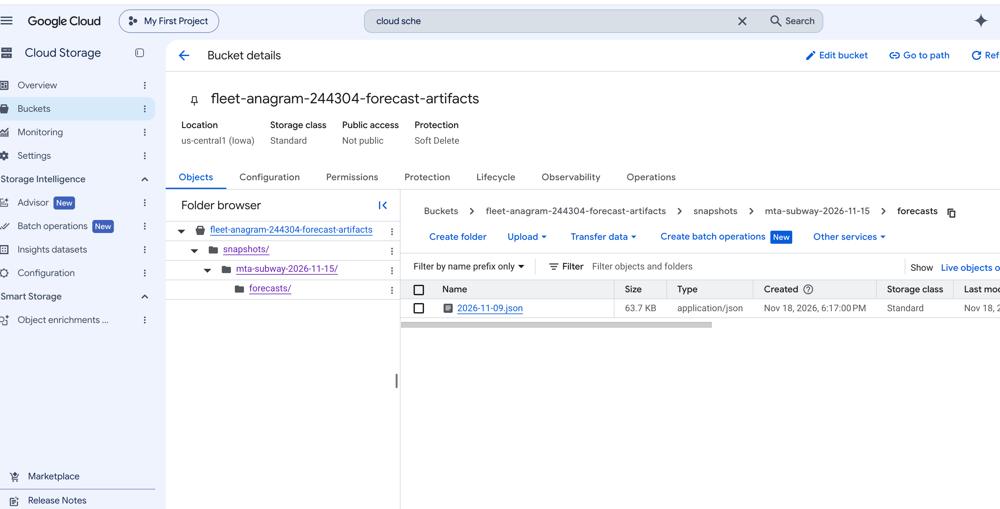
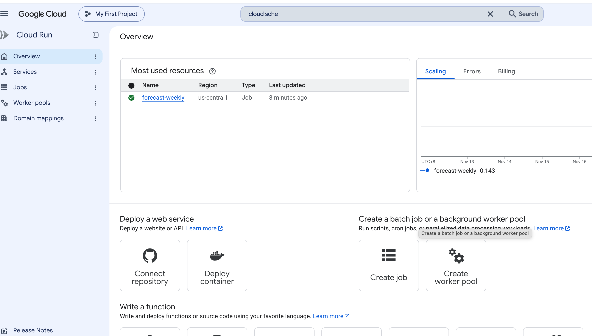
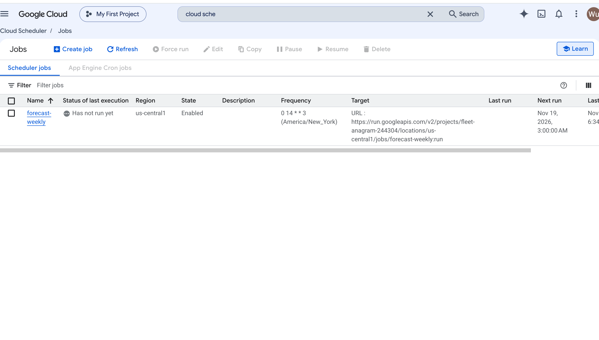

# Agentic Hill Climbing

An AI agent proposes Python models for seven-day NYC subway ridership forecasts. A separate evaluator tests each proposal and keeps it only if it beats both the current model and a baseline that refits without an agent.

## Demo result

In a one-off Cloud Run replay for **November 9–15, 2026**, GPT‑6.2 Sol proposed three candidates. The evaluator promoted one, and the job published all seven predictions to Cloud Storage.

| Model | Mean absolute error (riders/day) |
| --- | --- |
| Refitted baseline | 201,987 |
| Promoted model | **92,377 (54% lower)** |

This is one held-out replay week, not a result for the full scheduled campaign.



## How the scheduled replay works

1. **Pick the next week.** Cloud Scheduler triggers `forecast-weekly` on Wednesdays at 2 p.m. New York time. The job picks the earliest unpublished week in an eight-week campaign using a [pinned MTA snapshot](orchestrator/data/mta-subway-2026-11-15.json). It does not call the [live MTA feed](https://data.ny.gov/d/sayj-mze2).
2. **Propose and test.** The OpenCode SDK proposes up to three Python models. Candidates run in isolated Python sandboxes without network access. Four search weeks determine which proposal advances.
3. **Promote and publish.** The best proposal from search must beat both the incumbent and the refitted baseline on three separate promotion weeks. The evaluator then scores the selected model on the target week, whose actuals were not used for training or promotion.
4. **Carry the winner forward.** Cloud Storage holds one write-once result per week. Each run starts from the previous campaign winner, or the baseline for week one. After eight weeks, subsequent runs exit without calling the model.

## Run locally

You’ll need Bun and Docker. Start with the baseline replay, which requires no API key:

```sh
bun install --cwd orchestrator --frozen-lockfile
docker build -f sandbox/Dockerfile --target sandbox -t hill-climbing-python .
cd orchestrator
bun test
bun run forecast --baseline-only
```

To run the agent loop, configure credentials for your OpenCode provider (for example, `OPENAI_API_KEY`) and run from `orchestrator/`:

```sh
FORECAST_MODEL=openai/gpt-6.2-sol bun run forecast
```

To use an account already connected to a **running local OpenCode service** instead, also set `FORECAST_USE_LOCAL_SERVICE=1`. This option is local only.

| Command | What it runs |
| --- | --- |
| `bun run forecast` | Replay November 9–15, 2026, the last complete week in the snapshot. Pass an earlier start date, such as `2026-11-02`, to replay a different week. |
| `bun run forecast --replay-next` | Advance the eight-week campaign by one window, starting with September 21–27, 2026. |
| `bun run forecast --live` | Forecast seven days starting today in New York. If recent MTA data is incomplete, the job stops without publishing. |

Local results go under `artifacts/`. One-off replays use `snapshots/<snapshot-id>/`, scheduled-style replays use `snapshots/<snapshot-id>/campaign/`, and live results stay separate. Add `--baseline-only` for a baseline run in any mode. When running one-off dates, use chronological order so each replay can use the previous winner.

## Deployment

GitHub Actions verifies pull requests and deploys the tested image to Cloud Run on pushes to `main`. Deployments don’t trigger a forecast or change the schedule. See the [GCP setup and scheduling guide](infra/README.md).

<details>
<summary>Google Cloud deployment screenshots</summary>

**Cloud Run:** the deployed `forecast-weekly` job in `us-central1`.



**Cloud Scheduler:** the weekly trigger was enabled but hadn’t fired when this screenshot was taken.



</details>

- [`orchestrator/`](orchestrator/): Bun and TypeScript orchestration, scoring, and artifact storage
- [`sandbox/`](sandbox/): Python runtime and candidate executor
- [`candidates/`](candidates/): Candidate interface and refitted baseline
